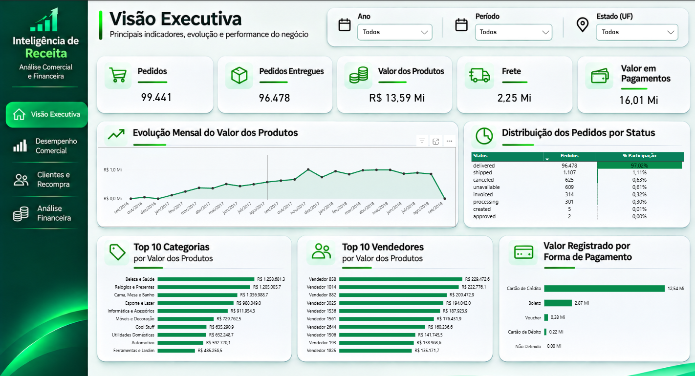
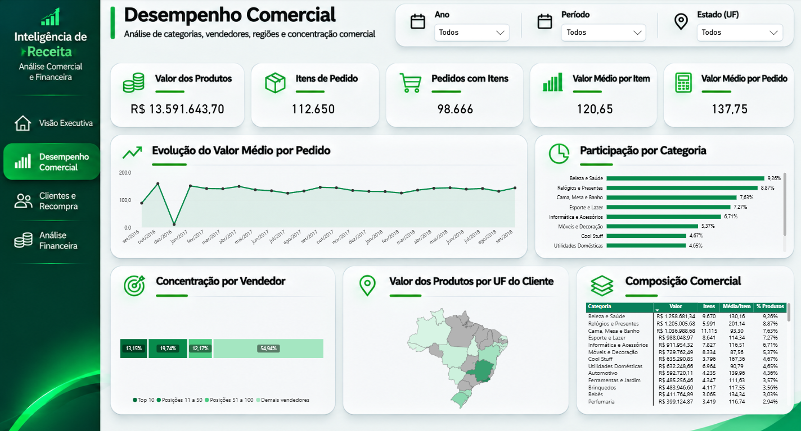
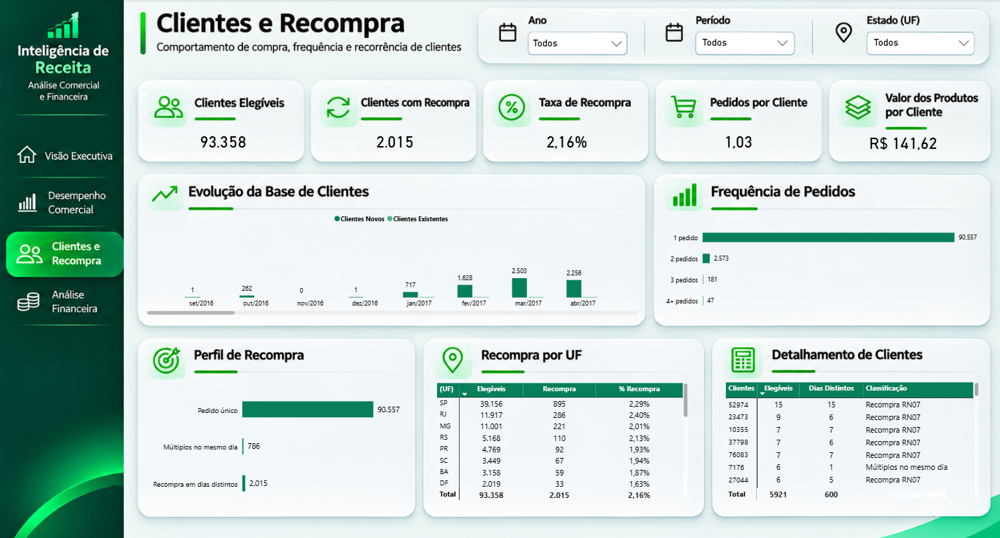
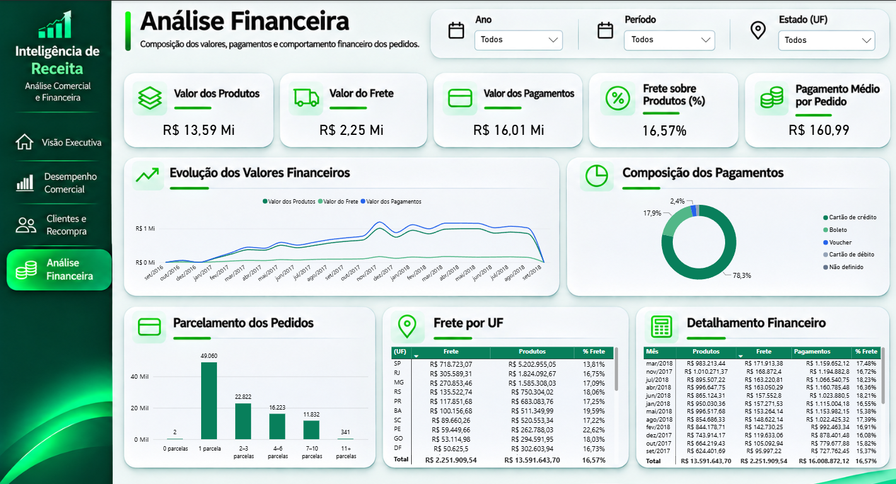

# Inteligência de Receita | Análise Comercial e Financeira

**Engenharia de dados, modelagem dimensional e Business Intelligence com Python, PostgreSQL, SQL e Power BI.**

Projeto de portfólio desenvolvido a partir dos dados públicos da Olist, com foco na construção de uma base analítica rastreável para estudar pedidos, produtos, frete, pagamentos, clientes e desempenho comercial.

A solução percorre o tratamento dos arquivos de origem, a organização em camadas de dados, a modelagem dimensional e a apresentação dos resultados no Power BI.

> **Nota de interpretação:** o título do projeto representa seu tema de negócio. Os dados disponíveis não permitem apurar, por si só, receita contábil, recebimento efetivo, custos, margem ou lucro. Valores de produtos, frete e pagamentos registrados são tratados como medidas distintas.

## Tecnologias

- **Python:** inventário, profiling, automação e verificações de qualidade.
- **PostgreSQL e SQL:** tratamento, persistência, modelagem dimensional e reconciliações.
- **Power BI e DAX:** modelo semântico, indicadores e dashboards interativos.
- **Git/GitHub:** versionamento e documentação do projeto.

## Arquitetura de dados

```text
Arquivos CSV da Olist
        |
        v
Bronze — preservação e inventário dos arquivos originais
        |
        v
Silver — dados tratados e verificados no PostgreSQL
        |
        v
Gold — modelo dimensional no PostgreSQL
        |
        v
Power BI — análise comercial e financeira
```

A separação por camadas facilita a rastreabilidade das transformações e a comparação entre os dados de origem e as tabelas de consumo.

As verificações de qualidade incluem reconciliação Silver × Gold, testes de integridade referencial e conferência das agregações.

## Modelo dimensional

A camada Gold segue a abordagem de **esquema estrela (Star Schema)**, com fatos em granularidades explícitas e dimensões compartilhadas.

| Tabela fato | Granularidade |
| --- | --- |
| `gold.fato_pedidos` | Um registro por `order_id` |
| `gold.fato_itens_pedido` | Um registro por `order_id` e `order_item_id` |
| `gold.fato_pagamentos` | Um registro por `order_id` e `payment_sequential` |

### Dimensões

- `dim_clientes`
- `dim_produtos`
- `dim_vendedores`
- `dim_calendario`
- `dim_localizacao`
- `dim_forma_pagamento`

O modelo contém **17 chaves estrangeiras físicas** entre fatos e dimensões.

As chaves substitutas técnicas `-1` (*não informado*) e `-2` (*referência não encontrada*) permitem distinguir ausência de informação de problemas de resolução dimensional.

Não há relacionamento direto entre tabelas fato nem distribuição arbitrária de pagamentos entre produtos ou vendedores.

A dimensão de localização considera a combinação de CEP prefixo, cidade e UF associada ao cliente no pedido, evitando multiplicações causadas pela base bruta de geolocalização.

Mais detalhes: [Modelo dimensional](docs/modelagem/modelo_dimensional.md) e [Regras de negócio](docs/regras_negocio/regras.md).

## Regras de negócio e indicadores

As análises respeitam definições explícitas de população, granularidade e período:

- **Pedidos:** preservam todos os status existentes na origem; análises de pedidos entregues usam exclusivamente `order_status = 'delivered'`.
- **Valor de produtos:** soma de `price` na tabela de itens, sem incluir frete.
- **Frete:** soma separada de `freight_value`.
- **Pagamentos registrados:** soma de `payment_value`, sem interpretação automática como receita reconhecida ou caixa recebido.
- **Clientes:** identificação analítica por `customer_unique_id`.
- **Recompra (RN07):** cliente com pelo menos dois pedidos `delivered` realizados em dois dias civis de compra distintos.
- **Análise temporal:** mês e ano de compra; datas de pagamento ou recebimento não são inferidas.

Pedidos, itens e pagamentos são analisados em suas próprias granularidades.

Em reconciliações por pedido, itens e pagamentos são agregados separadamente antes da comparação, evitando multiplicação de valores por junções entre fatos.

## Resultados e validação

As verificações SQL documentadas para a versão estática analisada registraram:

| Indicador de controle | Resultado |
| --- | ---: |
| Pedidos | 99.441 |
| Linhas de itens | 112.650 |
| Registros de pagamento | 103.886 |
| Identidades de clientes na dimensão | 96.096 |
| Valor de produtos (`price`) | 13.591.643,70 |
| Valor de frete (`freight_value`) | 2.251.909,54 |
| Valor de pagamentos registrados (`payment_value`) | 16.008.872,12 |

Os valores monetários acima são reproduzidos conforme os campos de origem, **sem atribuição de símbolo de moeda** nesta documentação.

A validação analítica registrou **130 verificações sem falhas**, incluindo **20 comparações Silver × Gold com zero diferenças**.

A reconciliação SQL de referência para a primeira página do Power BI registrou **78 verificações SQL/Decimal aprovadas**, além de três verificações de investigação.

Esses resultados comprovam a consistência das consultas e cargas nos escopos testados; não substituem a conferência da equivalência entre os valores exibidos no Power BI e as referências SQL.

A revisão dos dashboards foi informada como concluída, mas o registro formal dessa conferência deve ser incorporado às evidências antes de declarar aprovação documental completa.

**Evidências:**

- [Validação analítica](docs/qualidade/etapa5_validacao_analitica.md)
- [Reconciliação da Visão Executiva](docs/qualidade/etapa6c_reconciliacao_pagina1.md)

## Dashboards no Power BI

O relatório está organizado em quatro páginas interativas, com análises de desempenho comercial, comportamento dos clientes e medidas financeiras disponíveis na base.

As páginas permitem explorar diferentes recortes temporais e geográficos, respeitando as regras de negócio e a granularidade dos indicadores.

### 1. Visão Executiva

Apresenta uma visão consolidada dos principais indicadores do negócio, incluindo:

- Quantidade de pedidos e pedidos entregues.
- Valores de produtos, frete e pagamentos registrados.
- Evolução mensal do valor dos produtos.
- Distribuição dos pedidos por status.
- Participação de categorias e vendedores.
- Composição dos pagamentos por forma de pagamento.

A página permite acompanhar os principais resultados comerciais e identificar padrões na distribuição dos pedidos e valores registrados.



### 2. Desempenho Comercial

Explora o desempenho comercial considerando produtos, categorias, vendedores e localização dos clientes.

A página apresenta:

- Valor total dos produtos.
- Quantidade de itens comercializados.
- Quantidade de pedidos com itens.
- Indicadores médios de valor.
- Participação das categorias no valor dos produtos.
- Concentração comercial por vendedor.
- Distribuição geográfica do valor dos produtos.

As análises geográficas consideram a localização associada ao cliente no pedido. Unidades federativas sem registros no contexto selecionado podem aparecer sem preenchimento de dados.



### 3. Clientes e Recompra

Analisa o comportamento de compra dos clientes, considerando frequência de pedidos, recorrência e distribuição geográfica.

Os indicadores de recompra seguem a regra RN07, que exige pelo menos dois pedidos entregues em dias civis de compra distintos.

A página apresenta:

- **Clientes Elegíveis:** população de clientes considerada conforme as regras analíticas.
- **Clientes com Recompra:** clientes classificados como recorrentes pela RN07.
- **Taxa de Recompra:** proporção de clientes elegíveis que atendem à RN07.
- **Pedidos por Cliente:** média de pedidos por cliente no contexto analisado.
- **Valor dos Produtos por Cliente:** valor médio dos produtos por cliente.
- **Evolução da Base de Clientes:** acompanhamento mensal de clientes novos e existentes no contexto selecionado.
- **Frequência de Pedidos:** distribuição dos clientes conforme a quantidade de pedidos.
- **Perfil de Recompra:** distinção entre pedido único, múltiplos pedidos no mesmo dia e recompra em dias distintos.
- **Recompra por UF:** distribuição geográfica dos clientes elegíveis e recorrentes.
- **Detalhamento de Clientes:** consulta das classificações de recorrência.

O gráfico de evolução preserva os períodos exibidos pela dimensão calendário, inclusive meses com valores zero.

Esses valores representam o resultado das medidas no respectivo contexto temporal e não devem ser interpretados automaticamente como queda no desempenho comercial.

A análise diferencia frequência de pedidos e recompra: um cliente pode realizar múltiplos pedidos no mesmo dia sem atender à regra RN07.



### 4. Análise Financeira

Apresenta as medidas financeiras disponíveis na base, preservando a distinção entre valores de produtos, frete e pagamentos registrados.

A página reúne:

- Valor total dos produtos.
- Valor total do frete.
- Valor dos pagamentos registrados.
- Participação do frete em relação ao valor dos produtos.
- Valor médio dos pagamentos por pedido.
- Evolução mensal das medidas financeiras.
- Composição dos pagamentos por forma de pagamento.
- Distribuição dos registros por quantidade de parcelas.
- Distribuição geográfica dos valores de frete.

Os indicadores não representam, necessariamente, receita contábil, recebimentos efetivos, custos ou lucro.

A interpretação das séries temporais deve considerar a cobertura dos dados disponíveis, especialmente em períodos sem registros ou com cobertura parcial.



### Acesso ao relatório

O arquivo `.pbix` permite abrir o relatório no Power BI Desktop.

O repositório também contém artefatos do projeto Power BI em formato PBIP, incluindo definições do relatório e do modelo semântico.

Para reproduzir a atualização de dados, é necessário configurar a conexão com um banco PostgreSQL preparado com as tabelas do projeto.

Caminhos e credenciais locais não fazem parte da documentação pública.

## Organização do repositório

```text
data/
  bronze/                 # Arquivos originais e insumos de origem
scripts/                  # Rotinas de profiling, carga e validação
sql/
  silver/                 # Tratamentos da camada Silver
  gold/                   # Definição e carga de dimensões e fatos
  validacoes/             # Consultas e reconciliações analíticas
tests/                    # Testes automatizados
docs/
  arquitetura/            # Planejamento e decisões
  modelagem/              # Especificação dimensional
  regras_negocio/         # Definições e restrições analíticas
  qualidade/              # Relatórios e evidências de execução
  powerbi/                # Documentação do modelo semântico
  imagens/                # Capturas das páginas do dashboard
powerbi/                  # Artefatos do Power BI
```

## Reprodução e rastreabilidade

O projeto foi desenvolvido com **Python 3.10+** e **PostgreSQL 18.6** no ambiente de validação documentado.

Para executar o profiling dos CSVs, na raiz do repositório:

```powershell
python scripts/profiling.py
python -m unittest discover -s tests -v
```

Para reproduzir a validação analítica no banco PostgreSQL já configurado, o projeto documenta o executor:

```powershell
powershell -NoProfile -ExecutionPolicy Bypass -File .\scripts\executar_validacao_analitica.ps1
```

A execução exige a configuração local protegida descrita na documentação técnica.

**Não publique credenciais, arquivos de configuração sensíveis ou dados de conexão.**

A reprodução completa das cargas deve seguir a sequência e os pré-requisitos registrados nos scripts e relatórios de cada etapa. Não é seguro executar cargas fora de ordem.

## Limitações conhecidas

- A base representa uma **extração estática**; a estratégia atual de SKs e cargas não deve ser considerada pronta para atualização incremental sem revisão.
- Foram identificados **775 pedidos sem itens** e **1 pedido sem pagamento** no universo analisado.
- Há **303 pedidos comparáveis** com diferença absoluta superior a `0,01` entre pagamentos e soma de produtos mais frete. As diferenças foram preservadas, sem ajustes arbitrários ou atribuição de causa.
- Existem **610 produtos sem categoria** e **13 referências de categoria sem tradução correspondente**.
- Não há histórico de mudanças de status, comprovação de liquidação financeira nem dados suficientes para calcular custo, margem ou lucro.
- A procedência exata, versão e condições de licenciamento dos arquivos utilizados precisam ser confirmadas antes de redistribuir os dados brutos.

## Documentação técnica

- [Planejamento da arquitetura](docs/arquitetura/planejamento.md)
- [Modelo dimensional](docs/modelagem/modelo_dimensional.md)
- [Regras de negócio](docs/regras_negocio/regras.md)
- [Validação analítica SQL](docs/qualidade/etapa5_validacao_analitica.md)
- [Reconciliação SQL da Visão Executiva](docs/qualidade/etapa6c_reconciliacao_pagina1.md)

---

**Objetivo do portfólio:** demonstrar competências em engenharia e análise de dados, modelagem dimensional, SQL, qualidade, rastreabilidade e construção de indicadores orientados ao negócio, com transparência sobre as limitações da fonte.
