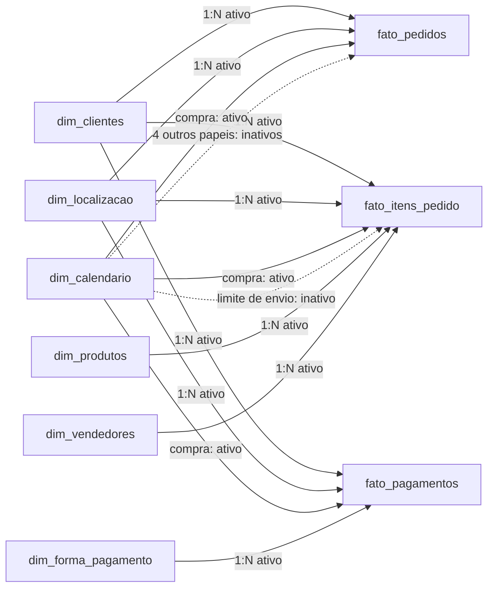

# Planejamento do modelo semântico Power BI

## Finalidade e referências

Este plano orienta a implementação posterior do modelo semântico e de quatro páginas de análise. A fonte será exclusivamente a Gold de `inteligencia_receita_db`. Nesta etapa não foram criados arquivo Power BI, conexão, consulta ao banco, transformação, tabela adicional, relacionamento ou medida DAX. As definições de medidas abaixo são contratos de negócio preliminares, sem expressões executáveis.

Foram confrontados o [modelo dimensional](../modelagem/modelo_dimensional.md), as [RN01–RN08](../regras_negocio/regras.md), o [relatório aprovado da Etapa 5](../qualidade/etapa5_validacao_analitica.md), os DDLs [das dimensões](../../sql/gold/001_dimensoes.sql) e [dos fatos](../../sql/gold/003_fatos.sql), as cargas Gold e as [24 consultas analíticas existentes](../../sql/validacoes/analitica/). Os números apresentados são referências dessas evidências, não resultados de uma execução Power BI.

O modelo lógico contém pendências históricas já resolvidas nas implementações posteriores: as SKs foram materializadas; `-1` significa não informado e `-2`, referência não encontrada; os filhos já possuem status e timestamp de compra contextuais. A RN07 foi calculada na Etapa 5. Este plano usa essas evidências posteriores sem reescrever documentos aprovados nem reabrir as regras.

## 1. Fonte, armazenamento e colunas

Recomendo **Import para as nove tabelas**, sem modelo composto ou Dual. A versão é estática, com 315.977 linhas distribuídas em três grãos factuais e 148.507 membros nas seis dimensões. O volume conhecido e a ausência de requisito de tempo real favorecem uma fotografia local para exploração e comparação com SQL; o tamanho comprimido e a latência ainda precisam ser medidos. Import guarda uma cópia e exige atualização para refletir mudanças; DirectQuery consulta a fonte durante a exploração e adicionaria dependência operacional do PostgreSQL sem necessidade demonstrada neste projeto. Essa avaliação segue a documentação de [modos de modelo semântico](https://learn.microsoft.com/en-us/power-bi/connect-data/service-dataset-modes-understand) e [DirectQuery](https://learn.microsoft.com/en-us/power-bi/connect-data/desktop-use-directquery).

A atualização futura deve carregar a mesma versão estática nas nove tabelas e só disponibilizar resultados após a reconciliação. Não presumir que consultas de importação separadas constituem uma transação única no PostgreSQL: manter a fonte estável durante a atualização e conferir versões e contagens. Agendamento, gateway e publicação dependem do ambiente de destino; não são configurados nesta etapa. Credenciais ficam no mecanismo protegido do conector, sem reprodução de segredos ou uso de executores de carga.

### Inventário de importação

Todas as tabelas abaixo pertencem ao schema `gold`. As colunas enumeradas são o conjunto inicial necessário; campos de auditoria ficam ocultos da navegação comum, mas disponíveis para validação.

| Tabela e grão | Colunas necessárias | Uso e exposição |
| --- | --- | --- |
| `dim_clientes`: identidade analítica | `cliente_sk`, `customer_unique_id`, `membro_tipo` | SK para relação; identidade anonimizada para detalhe e auditoria. Sem localização permanente |
| `dim_produtos`: produto | `produto_sk`, `product_id`, `product_category_name`, `product_category_name_english`, `membro_tipo` | Produto e categoria original para cortes comerciais. Tradução opcional, preservando ausências |
| `dim_vendedores`: vendedor | `vendedor_sk`, `seller_id`, `seller_zip_code_prefix`, `seller_city`, `seller_state`, `membro_tipo` | Identificação; geografia explicitamente do vendedor, diferente da localização contextual do cliente |
| `dim_calendario`: dia civil ou membro especial | `data_sk`, `dia`, `ano`, `mes`, `dia_mes`, `membro_tipo` | Calendário compartilhado e papéis descritos adiante |
| `dim_localizacao`: tupla exata CEP/cidade/UF do registro ligado ao pedido | `localizacao_sk`, `customer_zip_code_prefix`, `customer_city`, `customer_state`, `membro_tipo` | Cortes geográficos do contexto de cada pedido, sem geolocalização bruta |
| `dim_forma_pagamento`: método | `forma_pagamento_sk`, `payment_type`, `membro_tipo` | Método registrado; `not_defined` continua membro regular |
| `fato_pedidos`: `order_id` | `order_id`, `customer_id`, `order_status`; `order_purchase_timestamp`, `order_approved_at`, `order_delivered_carrier_date`, `order_delivered_customer_date`, `order_estimated_delivery_date`; `cliente_sk`, `localizacao_sk`; `data_compra_sk`, `data_aprovacao_sk`, `data_transportadora_sk`, `data_entrega_sk`, `data_previsao_entrega_sk` | Importar as 15 colunas existentes. Base dos pedidos, clientes e RN07; preservar todos os status e pedidos sem filhos |
| `fato_itens_pedido`: `order_id + order_item_id` | `order_id`, `order_item_id`, `product_id`, `seller_id`, `shipping_limit_date`, `price`, `freight_value`; `customer_id`, `order_status`, `order_purchase_timestamp`; `cliente_sk`, `localizacao_sk`, `produto_sk`, `vendedor_sk`, `data_compra_sk`, `data_limite_envio_sk` | Importar as 16 colunas existentes. Valores de itens e frete separados; contexto já resolvido na Gold |
| `fato_pagamentos`: `order_id + payment_sequential` | `order_id`, `payment_sequential`, `payment_type`, `payment_installments`, `payment_value`; `customer_id`, `order_status`, `order_purchase_timestamp`; `cliente_sk`, `localizacao_sk`, `forma_pagamento_sk`, `data_compra_sk` | Importar as 12 colunas existentes. Parcelas e identificadores sem agregação automática |

Os oito atributos numéricos descritivos de produtos não são necessários às páginas propostas: comprimentos de nome/descrição, fotos, peso e dimensões físicas ficam fora da importação inicial. Sua inclusão futura exige objetivo analítico e unidades confirmadas, sem tratar comprimento como texto de nome ou descrição.

### Tipos, apresentação e preservação

- SKs: número inteiro de 64 bits, preservando inclusive os negativos; relacionamentos nunca pelas identidades textuais ou por concatenações.
- IDs naturais, sequências e prefixos de CEP: texto, sem conversão, preenchimento, limpeza ou alteração de caixa. `order_id` permanece degenerado em cada fato, oculto salvo no detalhe; não origina outra dimensão.
- Valores monetários: candidato **número decimal fixo**, sem símbolo de moeda. Antes de adotá-lo, demonstrar que cada valor e agregado cabe na faixa e nas quatro casas suportadas, sem perda; `NUMERIC` PostgreSQL não tem equivalência irrestrita no Power BI. Não aceitar coerção ou arredondamento silencioso. O decimal comum usa ponto flutuante e não deve substituir a exigência de reconciliação exata. Referência: [tipos de dados Power BI](https://learn.microsoft.com/en-us/power-bi/transform-model/desktop-data-types).
- Timestamps: data/hora sem conversão de fuso; preservar os campos importados e usar `dia` relacionado para agrupamentos civis. Validar precisão do conector e do motor contra a origem, especialmente se surgirem frações de segundo; a Gold continua fonte do original íntegro.
- Desativar detecção automática de relacionamentos e data/hora automática. Ocultar SKs, FKs e colunas redundantes dos fatos na navegação comum. Definir “não resumir” para identificadores, parcelas e atributos; publicar somente medidas explícitas.
- Preservar `-1` e `-2` em todas as dimensões. Apresentar seus motivos distintos com auxílio de `membro_tipo`, não apenas o identificador natural nulo. Rótulos de apresentação futuros não substituem valores de origem. Não criar membro “não aplicável” sem justificativa.
- Validar a diferença entre a comparação textual `COLLATE "C"` da origem e a comparação do motor Power BI. Agrupamentos visuais por texto podem reunir grafias que a origem distingue, mesmo quando as relações por SK são corretas. Confrontar a cardinalidade textual e os grupos completos com SQL; se houver colisão, definir apresentação distinguível pela SK e rótulo original, sem normalizar a Gold. Não afirmar preservação literal da exibição sem esse teste. A [documentação dos tipos](https://learn.microsoft.com/en-us/power-bi/transform-model/desktop-data-types) descreve a insensibilidade a caixa do motor.

## 2. Relacionamentos e calendário

Recomendo manter as seis dimensões e as três tabelas fato, com **17 relacionamentos 1:N**, dimensão no lado 1 e fato no lado N. O filtro será sempre **único, dimensão → fato**. Não haverá relação fato–fato, dimensão–dimensão, N:N, ponte ou relacionamento por `order_id`.

As setas representam propagação de filtro, não junções de detalhes. Cada ligação temporal também é 1:N. A seta pontilhada para pedidos resume quatro relacionamentos distintos.

| Dimensão/chave no lado 1 | Pedidos: FK e estado | Itens: FK e estado | Pagamentos: FK e estado |
| --- | --- | --- | --- |
| Clientes / `cliente_sk` | `cliente_sk`, ativo | `cliente_sk`, ativo | `cliente_sk`, ativo |
| Localização / `localizacao_sk` | `localizacao_sk`, ativo | `localizacao_sk`, ativo | `localizacao_sk`, ativo |
| Produtos / `produto_sk` | — | `produto_sk`, ativo | — |
| Vendedores / `vendedor_sk` | — | `vendedor_sk`, ativo | — |
| Forma de pagamento / `forma_pagamento_sk` | — | — | `forma_pagamento_sk`, ativo |
| Calendário / `data_sk`: compra | `data_compra_sk`, ativo | `data_compra_sk`, ativo | `data_compra_sk`, ativo |
| Calendário / `data_sk`: aprovação | `data_aprovacao_sk`, inativo | — | — |
| Calendário / `data_sk`: transportadora | `data_transportadora_sk`, inativo | — | — |
| Calendário / `data_sk`: entrega ao cliente | `data_entrega_sk`, inativo | — | — |
| Calendário / `data_sk`: previsão de entrega | `data_previsao_entrega_sk`, inativo | — | — |
| Calendário / `data_sk`: limite de envio | — | `data_limite_envio_sk`, inativo | — |

São **12 ativos e cinco inativos**, correspondentes às 17 FKs. A compra é a referência comum dos três fatos. Medidas futuras por outro papel precisam ativar explicitamente o relacionamento correspondente somente durante sua avaliação e garantir que compra não permaneça como restrição temporal concorrente naquele fato. Cada visual indicará seu papel: um valor por data de entrega não será comparado a pagamentos por compra sob o título genérico “por período”. Referência: [relacionamentos ativos e inativos](https://learn.microsoft.com/en-us/power-bi/guidance/relationships-active-inactive).

Este desenho não permite dois segmentadores independentes, por exemplo compra e entrega, usando a mesma dimensão. Duplicar calendários por papel é uma alternativa de implementação se essa necessidade surgir, mas adicionaria tabelas semânticas e exige revisão de escopo; não integra a proposta inicial nem foi executado aqui.

### Conflito entre calendário completo e tabela de datas

O calendário Gold tem 1.314 dias regulares contíguos, de 2016-09-04 a 2020-04-09, além de dois membros especiais com `dia` nulo. A marcação clássica de tabela de datas exige valores únicos, não nulos e contíguos. Portanto, **não marcar o calendário completo como tabela de datas** e não fabricar datas para os especiais. Referência: [requisitos de tabela de datas](https://learn.microsoft.com/en-us/power-bi/transform-model/desktop-date-tables).

Na proposta inicial, importar todos os membros e usar atributos civis explícitos para dia, ano e mês, sem funções de inteligência temporal que dependam dessa marcação. Ano e mês devem permanecer juntos no eixo; mês isolado mistura anos. Uma apresentação ano-mês ordenada pelo primeiro dia do mês poderá ser especificada depois, sem criar tabela adicional. Não introduzir calendário automático, fiscal, feriados, semanas ou variações anuais nesta etapa.

O calendário até 2020 atende a todos os papéis, mas não indica compras até 2020. Os filtros de compra devem explicitar a cobertura observada de 2016-09-04 a 2018-10-17 e os meses parciais; dias sem eventos não devem aparecer como vendas zero por preenchimento implícito. Ausência de data mantém o registro no total sem filtro temporal; um recorte de dias conhecidos naturalmente não o inclui e precisa mostrar o volume sem data, por papel.

## 3. Caminhos de filtro e escopos incompatíveis

Compartilhar cliente, localização e compra não cria propagação entre fatos quando todas as relações são unidirecionais: uma dimensão filtra cada processo em paralelo, e um fato não devolve filtro à dimensão. As dimensões conformadas não autorizam misturar suas linhas factuais. Filtros bidirecionais podem abrir rotas como produto → itens → cliente → pagamentos, atribuindo pagamentos ao universo de clientes de um produto, sem comprovar correspondência transacional. Ficam excluídos do desenho, conforme a orientação de [minimizar relações bidirecionais](https://learn.microsoft.com/en-us/power-bi/guidance/relationships-bidirectional-filtering).

| Contexto | Efeito permitido | Risco e controle proposto |
| --- | --- | --- |
| Compra, cliente ou localização contextual | Filtra os três fatos independentemente | Totais comparáveis apenas com a mesma seleção e sem filtros exclusivos adicionais |
| Produto, categoria ou vendedor | Filtra somente itens | Não apresentar pagamentos ou pedidos de `fato_pedidos` em linhas desses atributos: o total repetido seria enganoso. Usar pedidos distintos do próprio fato de itens |
| Método | Filtra somente pagamentos | Pedidos com esse método vêm do fato de pagamentos. Não mostrar valor de produtos ou frete por método |
| Atributo de um fato, inclusive status | Filtra somente esse fato | Não pressupor filtro global. Impedir interações que sugiram atualização conjunta; status deve ser explícito no processo de origem |
| Seleção de `order_id` em um detalhe | Filtra somente a tabela de origem | Não tentar corrigir com relação fato–fato. Uma futura auditoria por pedido exige aplicação explícita do mesmo conjunto de IDs a cada fato, com agregação independente e teste próprio |
| Outros papéis temporais | Filtram o processo e papel da medida específica | Não inferir entrega de um pagamento nem propagar papel alternativo para os demais fatos |

Não propor uma dimensão nova de status. Nas páginas com múltiplos processos, comparar medidas explicitamente nomeadas “geral” e “delivered”; o gráfico de status de pedidos terá interações desligadas com cartões dos outros fatos. Segmentadores de status serão locais a blocos de um único processo, com indicação visível desse alcance. Um filtro global de status dinâmico exigiria contrato adicional de aplicação consistente às três colunas contextuais antes de escrever DAX.

Medidas futuras devem rejeitar ou sinalizar contexto incompatível quando expostas em exploração livre; não basta desativar interações de visuais. Não resolver incompatibilidade removendo filtros silenciosamente ou introduzindo relacionamento virtual entre processos sem contrato. Não exibir cartões financeiros ao lado de filtros de produto como se esses filtros os afetassem.

## 4. Catálogo preliminar de medidas

Os nomes abaixo são propostas. “Geral” significa todos os status **dentro do contexto aplicável**, sem filtro `delivered` implícito; não significa ignorar filtros. A versão “delivered” acrescenta a condição do status no próprio fato e a **intersecta** com qualquer seleção local de status. Selecionar `canceled` não pode retornar o total entregue por substituição silenciosa do filtro. Os valores gerais e entregues se sobrepõem e não são parcelas somáveis.

Denominador “—” indica medida absoluta. Todas as contagens distintas são recalculadas no contexto total, nunca obtidas pela soma das células. “Compra/local/cliente” indica filtros conformados; a coluna de filtros explicita extensões e restrições.

| Nome proposto | Definição e interpretação | Fato / grão de avaliação | Filtros aplicáveis | Denominador |
| --- | --- | --- | --- | --- |
| Pedidos — geral / Pedidos — delivered | Contar `order_id` distintos, preservando pedidos sem filhos; versão entregue por RN02 | Pedidos / pedido | Compra, local, cliente, status do pedido; não produto, vendedor ou método | — |
| Linhas de itens — geral / Linhas de itens — delivered | Contar ocorrências de item; não nomear quantidade física vendida | Itens / pedido-item | Compra/local/cliente, produto/categoria/vendedor, status contextual | — |
| Pedidos com itens — geral / Pedidos com itens — delivered | Contar pedidos distintos no fato de itens; não substituir contagem de todos os pedidos | Itens / pedido distinto no contexto de itens | Mesmos filtros de itens; não método | — |
| Valor bruto de produtos — geral / Valor bruto de produtos — delivered | Somar apenas `price`; sem chamar receita contábil | Itens / pedido-item | Mesmos filtros de itens | — |
| Frete — geral / Frete — delivered | Somar apenas `freight_value`; não presumir custo logístico | Itens / pedido-item | Mesmos filtros de itens | — |
| Registros de pagamento — geral / Registros de pagamento — delivered | Contar registros; sequência não equivale a parcela recebida | Pagamentos / pedido-sequência | Compra/local/cliente, método e status contextual; não produto/vendedor | — |
| Pedidos com pagamentos — geral / Pedidos com pagamentos — delivered | Contar pedidos distintos no fato de pagamentos; um pedido pode usar vários métodos | Pagamentos / pedido distinto no contexto de pagamentos | Mesmos filtros de pagamentos; totais por método não aditivos | — |
| Valor registrado em pagamentos — geral / Valor registrado em pagamentos — delivered | Somar `payment_value`; sem interpretar como recebimento ou fluxo de caixa | Pagamentos / pedido-sequência | Mesmos filtros de pagamentos | — |
| Clientes com pedidos — geral / Clientes com pedidos — delivered | Contar identidades regulares que participam dos pedidos selecionados, não linhas da dimensão ou `customer_id` | Pedidos / identidade via `cliente_sk` e dimensão | Compra/local/cliente, status; não produto/vendedor/método | — |
| Clientes com múltiplos pedidos — geral | Identidades regulares com ao menos dois pedidos distintos de qualquer status no universo declarado | Pedidos / identidade e pedido | Horizonte completo na referência SQL; demais cortes exigem explicitação | — |
| Clientes com múltiplos delivered | Identidades regulares com ao menos dois pedidos entregues; diagnóstico separado, ainda não prova RN07 | Pedidos / identidade e pedido | Horizonte completo; status fixado em delivered | — |
| Clientes elegíveis RN07 | Identidades regulares com ao menos um pedido delivered em dia de compra conhecido | Pedidos / identidade após seleção de pedidos elegíveis | Horizonte completo inicial; sem filtros exclusivos de outros fatos | É o denominador RN07 |
| Clientes com recompra observada RN07 | Identidades regulares com ao menos dois pedidos delivered em pelo menos dois dias civis de compra distintos | Pedidos / identidade e conjunto de dias elegíveis | Exatamente o mesmo universo do denominador | — |
| Proporção descritiva de recompra observada | Numerador RN07 dividido por clientes elegíveis RN07; não rotular retenção | Pedidos / razão de duas contagens distintas | Mesmo horizonte e seleção de ambos; não somar percentuais | Clientes elegíveis RN07; vazio quando zero |
| Pedidos sem itens — geral / delivered | Pedidos cujo conjunto de itens está ausente, mantendo o universo de pedidos | Pedidos e conjunto de IDs de itens, avaliados separadamente / pedido | Compra/local/cliente e mesmo status; não produto/vendedor/método | — |
| Pedidos sem pagamento — geral / delivered | Pedidos sem registro correspondente; diferente de valor registrado zero | Pedidos e conjunto de IDs de pagamentos / pedido | Mesmo contrato dos sem itens | — |
| Pedidos comparáveis — geral / delivered | Pedidos com itens e pagamentos, identificados por conjuntos independentes | Três fatos / pedido, sem relacionamento físico adicional | Apenas recortes comuns e mesmo status | — |
| Pedidos com divergência superior a 0,01 — geral / delivered | Contar comparáveis com diferença absoluta maior que 0,01, preservando o sinal no detalhe | Agregados independentes de itens e pagamentos / pedido | Mesmos filtros dos comparáveis; não produto/vendedor/método | — |

As últimas quatro famílias são propostas de diagnóstico, não medidas prontas. Sua implementação dependerá do contrato de avaliação por pedido, do tratamento de vazios e de testes contra a consulta 20. Não somar itens e pagamentos detalhados nem persistir totais artificiais em pedidos. A diferença assinada será pagamento menos produtos e frete, somente quando ambas as fontes existirem. Pequenas diferenças também permanecem observadas; 0,01 não é tolerância financeira aprovada. Nenhuma taxa de conversão, ticket médio, margem, lucro, custo, retenção ou calendário de recebimentos integra o catálogo inicial.

## 5. Clientes, filtros e recompra

Uma contagem direta de `dim_clientes` não responde quantos clientes compraram no período: em filtro único, a dimensão não é filtrada de volta pelos fatos. Contar clientes participantes no fato de pedidos, excluindo SKs técnicas e confirmando correspondência com o membro regular. Uma identidade pode aparecer em vários meses, cidades e produtos; o total deve ser reavaliado, não somado. A localização de cada participação é contextual ao pedido, sem residência permanente inferida.

A referência de RN07 será inicialmente **todo o horizonte observado**, reproduzindo a consulta [19_clientes_recompra.sql](../../sql/validacoes/analitica/19_clientes_recompra.sql). Numerador e denominador precisam do mesmo conjunto de pedidos: status `delivered`, cliente regular e dia de compra conhecido. Usar dias civis reais, não quantidade de SKs de calendário incluindo `-1`/`-2`. Excluir técnicos das contagens de identidade não exclui seus pedidos dos controles de qualidade gerais.

| Controle SQL aprovado | Referência sem filtros |
| --- | ---: |
| Identidades com pedidos, qualquer status | 96.096 |
| Identidades com múltiplos pedidos, qualquer status | 2.997 |
| Identidades com pelo menos dois delivered | 2.801 |
| Denominador: identidades com pelo menos um delivered em dia conhecido | 93.358 |
| Numerador: RN07 em pelo menos dois dias elegíveis | 2.015 |
| Múltiplos delivered que não satisfazem os dias distintos | 786 |
| Proporção descritiva | 2,1583581482036890% |

O percentual é referência matemática; a interface poderá mostrar 2,1584%, sem usar o arredondamento de apresentação para decidir elegibilidade. A cobertura e o tempo disponível para repetir compras variam; não há inferência de independência ou retenção por coorte.

No bloco RN07 não haverá segmentadores de produto, vendedor ou método, nem interação de seus visuais. Também não haverá filtro de status genérico que altere a elegibilidade fixa. Filtros de data e localização não serão sincronizados com esse bloco enquanto não se decidir entre: observar duas compras dentro da seleção; selecionar uma população e observar seu histórico completo; ou outro recorte explicitamente definido. Nenhuma dessas alternativas deve ser aplicada silenciosamente. Na proposta inicial, o bloco fica identificado como “horizonte completo da extração” e separado dos visuais exploratórios por período e localidade. Seleção de uma identidade para auditoria pode mostrar seus pedidos e dias, mantendo o percentual geral claramente separado.

Se futuramente forem solicitados “clientes de um produto” ou “recompra por método”, será preciso definir se o interesse é participação naquela ocorrência, histórico da identidade ou repetição do mesmo atributo. Não transportar automaticamente o conjunto de clientes de um fato para outro, pois isso incluiria pedidos e valores sem vínculo com o filtro original.

## 6. Proposta das quatro páginas

| Página | Objetivo e visuais propostos | Filtros e interações |
| --- | --- | --- |
| **Visão Executiva** | Resumir escala e composição sem misturar processos: cartões separados de pedidos, linhas de itens, valor de produtos, frete e valor registrado em pagamentos; pares claramente rotulados geral/delivered; evolução mensal de pedidos; barras por status; quadro dos pedidos sem filhos | Compra e localização contextual comuns aos processos. Sem produto/vendedor/método global. Status de pedidos afeta apenas o bloco de pedidos; desativar interação com os demais cartões. Indicar cobertura, meses parciais e ausência de moeda confirmada |
| **Desempenho Comercial** | Analisar itens: séries mensais de price e frete separados; barras por categoria, produto e vendedor; matriz com linhas de itens, pedidos distintos com itens, price e frete; tabela por UF/cidade do contexto do pedido | Compra, produto/categoria, vendedor e localização; status local de itens. Exibir versões geral/delivered sem trocar um filtro pelo outro. Produtos por ID, sem inventar nome. Categorias nulas e tradução ausente visíveis; rankings acompanhados de total completo. Nenhum pagamento por produto/vendedor |
| **Clientes e Recompra** | Mostrar identidades participantes, distribuição de pedidos por identidade, múltiplos pedidos versus múltiplos delivered e RN07; cartões de numerador, denominador e proporção; detalhe de pedidos/dias para auditoria; exploração contextual de clientes por período e UF/cidade em bloco separado | RN07 no horizonte completo, sem filtros de outros processos e sem sincronização temporal/geográfica. Bloco exploratório aceita compra/local/status do pedido, com título próprio. Não somar clientes entre meses ou localidades e não apresentar como residência |
| **Análise Financeira** | Examinar valores registrados em pagamentos por mês de compra, método e status; cartões de registros, pedidos com pagamentos e valor; quadro separado de reconciliação por pedido, com comparáveis, sem filhos e divergentes; tabela de sinais e detalhe apenas após validar o contrato por pedido | Compra, cliente e local comuns; método e status de pagamentos apenas no bloco de pagamentos. O método não filtra reconciliação dos três processos: manter bloco sem essa interação e identificá-lo, ou separar sua navegação. Sem produto/vendedor e sem denominar caixa/recebimento. Parcelamento somente descritivo, nunca soma comercial |

A montagem deverá testar todas as interações entre visuais, inclusive seleções e filtros de drill-through. Ausências não se tornam zero por formatação. O escopo aplicado deve constar no título ou em texto visível. Priorizar tabelas/barras geográficas; mapas e geocodificação não estão previstos sem evidência e decisão específicas.

## 7. Reconciliação Power BI × SQL

A validação futura usará a mesma versão estática e o mesmo contexto dos [resultados executados da Etapa 5](../qualidade/etapa5_validacao_analitica/20261108T042110748288Z/resultado.json). Os controles seguintes são alvos, não testes executados nesta entrega.

| Controle | Geral | Delivered | SQL de referência em `sql/validacoes/analitica/` |
| --- | ---: | ---: | --- |
| Pedidos distintos | 99.441 | 96.478 | 01; status em 02 e meses em 03 |
| Linhas de itens | 112.650 | 110.197 | 06; meses em 07 |
| Pedidos com itens | 98.666 | 96.478 | 06 |
| Price | 13.591.643,70 | 13.221.498,11 | 06; produto 08, categoria 09, vendedor 10 |
| Frete | 2.251.909,54 | 2.198.275,64 | 06–10 |
| Registros de pagamentos | 103.886 | 100.756 | 13; meses/método/status em 14–15 |
| Pedidos com pagamentos | 99.440 | 96.477 | 13 |
| Payment value | 16.008.872,12 | 15.422.461,77 | 13–15 |
| Pedidos sem itens | 775 | 0 | 20 |
| Pedidos sem pagamentos | 1 | 1 | 20 |
| Comparáveis | 98.665 | 96.477 | 20 |
| Divergências absolutas > 0,01 | 303 | 299 | 20 |
| Sinal positivo / negativo das divergências | 264 / 39 | 260 / 39 | 20 |

O roteiro de conferência será:

1. Conferir nove tabelas, contagens importadas, unicidade das SKs e dos três grãos, os 17 relacionamentos e seus estados. As dimensões completas esperadas têm 96.098 clientes, 32.953 produtos, 3.097 vendedores, 1.316 membros de calendário, 15.036 localidades e sete métodos, incluindo os técnicos. Nenhuma importação deve eliminar especiais ou fatos sem filhos.
2. Reconciliar os totais da tabela acima com precisão exata dos valores representáveis, antes de formatação. Não validar apenas cartões arredondados. Validar escala/faixa e comportamento do conector antes de qualquer DAX monetário; se houver perda, interromper a adoção do tipo e registrar a incompatibilidade.
3. Comparar todos os oito status: approved 2, canceled 625, created 5, delivered 96.478, invoiced 314, processing 301, shipped 1.107 e unavailable 609. Testar que canceled intersectado com medida delivered não retorna entregues. Data de entrega presente não substitui RN02; os oito delivered sem data continuam elegíveis.
4. Comparar todos os grupos mensais e as bordas temporais, não apenas um mês escolhido. Compra vai de 2016-09-04 a 2018-10-17; último mês de compra delivered é agosto de 2018. Em itens há compra até 2018-09-03. Testar que 2020 aparece somente nos papéis que o justificam e que mês vazio não vira zero observado. Para papéis alternativos, comparar com a evidência 23 e um recorte SQL de leitura equivalente antes de liberar a medida.
5. Reconciliar integralmente produtos, categorias e vendedores com 08–10, UF/cidade com 04–05, 11–12 e 16–17 e método/status com 14–15. Não somar pedidos distintos entre categorias ou métodos. Confirmar 1.603 linhas de itens sem categoria no geral, 1.537 delivered e três registros reais `not_defined`, todos canceled, com valor total 0,00. Preservar também categorias sem tradução, zeros e nulos.
6. Reproduzir o detalhe por identidade da consulta 18, os seis controles RN07 da seção 5 e os controles de técnicos/datas da consulta 24. Comparar o total recalculado, não a soma dos distintos por mês. Confirmar que dois pedidos no mesmo dia e pedidos não delivered não geram RN07; data de compra ausente ou identidade técnica não contam como dia ou cliente elegível.
7. Reconciliar por pedido a consulta 20 após agregação independente, incluindo igualdade exata, pequenas diferenças, valores acima de 0,01 e não comparáveis. Repetir por status, mês e UF, preservando 303 diferenças, sem compensar sinais. Não comparar pagamento filtrado por método com total integral dos itens do pedido como se os universos fossem iguais.
8. Testar filtros e interações adversos: produto não altera pagamento nem RN07; método não altera itens; status de um fato não se propaga; não surgem valores gerais repetidos em linhas de atributos incompatíveis. Verificar total de clientes menor ou igual à soma dos grupos quando houver sobreposição, sem exigir aditividade. Testar ausência de data e membros técnicos sem uni-los em uma identidade fictícia.

As futuras evidências deverão registrar versão da fonte e do Power BI, data da atualização, colunas/tipos efetivos, relacionamentos ativos/inativos, contexto de cada comparação, valores brutos exportados, resultado esperado, observado e diferença. A Etapa 5 comprova a Gold, mas não substitui esses testes no motor Power BI.

## 8. Decisões e limitações antes de escrever DAX

| Ponto | Encaminhamento proposto ou decisão necessária |
| --- | --- |
| Armazenamento e relações | Import e filtro único são a recomendação inicial; desempenho e tamanho ainda não medidos. Não habilitar relações automáticas ou bidirecionais para resolver visuais |
| Calendário com especiais | Manter completo e sem marcação clássica; medidas iniciais por atributos civis. Necessidade de calendários por papel, inteligência temporal e cortes simultâneos exige decisão própria, sem datas artificiais |
| Contrato de status | Geral e delivered explicitamente separados, com interseção de status local; não há segmentador global de status implementado. Confirmar essa experiência antes das medidas |
| RN07 sob seleção | Referência inicial é horizonte completo. Escolher e validar a semântica de futuras seleções de período/local/população antes de implementar variações. Nenhum KPI de retenção sem coorte e janela |
| Precisão e texto | Comprovar representação decimal sem perda, domínio de timestamps e preservação dos agrupamentos textuais. Colisões de apresentação e arredondamento são riscos a testar, não resultados já encontrados |
| Diagnóstico entre processos | Formalizar avaliação independente por pedido e vazios, sem relações adicionais; filtros exclusivos invalidam comparação integral. Não criar ponte, nova tabela ou rateio como atalho |
| Procedência, moeda e significado | Licença/procedência e moeda continuam pendentes. Não afirmar receita contábil, margem, lucro, custo ou recebimento. Pagamentos não têm data própria de liquidação comprovada |
| Exceções da fonte | Investigar 303 diferenças, ausências de filhos, zeros, `not_defined` e categorias sem tradução. Não reclassificar ou corrigir para fechar totais |
| Publicação e acesso | Definir ambiente, permissões de consumo, credencial de leitura, eventual gateway e política de atualização antes da disponibilização. Não inferir necessidade ou regra de RLS sem requisito de acesso |

O desenho prioriza rastreabilidade e comparação com os SQLs aprovados. A implantação posterior deverá começar pelos contratos de filtro, calendário e tipos, seguir pelas medidas básicas e somente então pela RN07 e pelos diagnósticos entre processos. A composição das páginas depende da conferência desses contratos; esta entrega permanece restrita ao planejamento.
